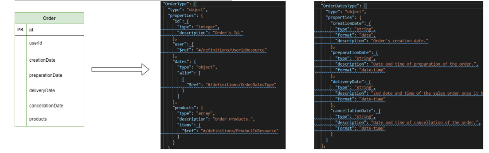

# Rules on the fornmat of messages
---

The standard text-based JSON (JavaScript Object Notation) format will be used to represent structured data in the JavaScript object syntax described in [RFC 8259](https://datatracker.ietf.org/doc/html/rfc8259).

## Message type technical requirements
---

The JSON message type will be used as the information structuring format.
The technical requirements at the HTTP header level are:


| __Head__ |  __Description__|__Value__  |__Request/Response__  |
|--|--|--|--|
| __Content-type__ |[Media type (MIME)](https://en.wikipedia.org/wiki/Media_type)  |application/json  | Response |
|  __Accept__|[Media type (MIME)](https://en.wikipedia.org/wiki/Media_type)  | application/json | Request |
|__Content-Length__  |Message size  |numeric bytes  | Request/Response  |


Example response HTTP headers:

```json
HTTP/1.1 200 OK
Content-Type: application/json;charset=UTF-8
Content-Length: 1024
...

```

### Exception

Both API consumers and servers must send JSON data using the application/json type in the HTTP Content-Type header, except for the exceptions described in [Transferring binary files](#transferring-binary-files).


## High level structure
---

The body of the messages __MUST consist__ of a JSON object. At the highest level, this object __MUST be__ made up of several sections:

- **data:** encapsulates the application's business data. Since they are specific, this field can contain any valid JSON value, mainly:

  **o**  or a simple field ("field_name")
  **o** or a field composition object ("{}")
  **o** or an array ("[]")
- **metadata:** normally technical (or business support) information about the application that cannot be modeled as resources or relationships between them.

- **error:** error document produced in the processing of a request.

these sections __MUST NOT be__ combined in any away, but __CAN__ give two possible configurations:

- **Successful:** reception of information: formed by the elements data (mandatory, with an object in '{}') and metadata.
- **Error:** composed of the error field (mandatory) and metadata.

```javascript
{
	"data": {
	...
	},
	"metadata": {
	...
	}
}

```
```javascript
{
      "error": {
	...
	},
      "metadata": {
	...
	}
}

```

In the same message, the data and error components are exclusive, since if business data is recovered it is because there is no error.

The main application data is a representation of the resource or a collection of resources requested by the consumer request. **MUST be**:

- A single resource object with a unique resource object identifier or null, for requests that refer to a single resource.

- A collection of resource objects, a collection of resource object identifiers, or an empty collection, for requests that refer to a collection of resources.

- A logical collection of resources MUST be represented as an array, even if it contains only one element or is empty.

### Error message structure
<br>

Error messages will be implemented following the standard __Problem Details__ [RFC9457](https://datatracker.ietf.org/doc/html/rfc9457) 

```javascript
{
   "type": "http://example.com/problems/already-available",
   "title": "Cannot set product as avaible.",
   "status": 400,
   "detail": "Product is already Avaible For Sale.",
   "instance": "/sales/products/abc123/availableForSales",
   "traceId": "00-45d1103f8d096f48a79f8fdc1496d51-d91f8ed29fa0841-00" 
}
```

- **type:** URI or relative path that defines what the problem is. In a similar way, as the first example had a “documentation” member, this is the intent of this member as well. It’s to allow the developer to understand the exact meaning of this error. However, this is meant to also be machine-readable. Meaning this URI should be stable and always represent the same error. This way we can write our client code to handle this specific type of error how we see fit. It’s acting in a similar way as an error code or error key.

- **title:** A short human-readable message of the problem type. It should NOT change from occurrence to occurrence. 

- **detail:** Human-readable explanation of the exact issue that occurred. This can differ from occurrence to occurrence.

- **instance:** A URI that represents the specific occurrence of the problem.


<br>

__Type & Extensions__    

the **traceId** is an extension. This allows you to provide more details to your clients when errors occur.

This is important because if you use the **type** member, which is the primary way you identify what the problem is, then you can provide more extension members based on the type you return.

In other words, in your HTTP API documentation, you can specify a problem type by its URI, and let the developer know there will be certain other extension members available to them for that specific problem.  

<br>

__Multiple Problems__

Problem Details has no explicit way of defining multiple problems in a single response. You can achieve this by defining a __specific type__, which indicates there will be a problems member which will be an array of the normal problem details members. Just as I described above to leverage bot the type and extensions together.

```javascript

{
    "type": "http://example.com/problems/multiple",
    "title": "Multiple Problems",
    "status": 400,
    "detail": "There were multiple problems that have occurred.",
    "instance": "/sales/products/abc123/availableForSale",
    "traceId": "00-45d1103f8d096f48a79f8fdc1496d51-d91f8ed29fa0841-00", 
    "problems": [
      {
        "type": "http://example.com/problems/already-available",
        "title": "Cannot set product as available.",
        "detail": "Product is already Available For Sale.",
        "instance": "/sales/products/abc123/availableForSale",
      },
      {
        "type": "http://example.com/problems/no-quantity",
        "title": "Cannot set product as available.",
        "detail": "Product has no Quantity on Hand.",
        "instance": "/sales/products/abc123/availableForSale",
      }
     ]
}
```

### Example error message structure

```javascript
{
      "error": 
      {
	    "type": "http://example.com/problems/already-available",
            "title": "Cannot set product as avaible.",
            "status": 400,
            "detail": "Product is already Avaible For Sale.",
            "instance": "/sales/products/abc123/availableForSales",
            "traceId": "00-45d1103f8d096f48a79f8fdc1496d51-d91f8ed29fa0841-00"
     }
      
}
````
# Type of data
---
<br>

The different types of data that can be used in [OAS 3.0](https://github.com/OAI/OpenAPI-Specification/blob/main/versions/3.0.0.md#dataTypes) are as follows:


| __Common__  |__type__  |__Format__  | __Comments__ |
|--|--|--|--|
|__integer__|integer| int32|signed 32 bits  |
|__long__|integer  |int64  | signed 64 bits |  
|__float__| number  |float |                |  
|__double__| number |double  |              |  
|__string__|  string|  |                    |  
|__byte__|string  |byte  |base64 encoded characters| 
|__binary__|string|binary|any sequence of octets|  
|__boolean__|boolean|      |As defined by full-date - [RFC3339](https://datatracker.ietf.org/doc/html/rfc3339)|   
|__date__|string|date  |  |
|__dateTime__  |string|date-time|As defined by date-time - [RFC3339](https://datatracker.ietf.org/doc/html/rfc3339)  |  
|__password__  |string|password  | A hint to UIs to obscure input|  

- One of the following standards __MUST always be__ used for data formatting:


|__Data type__  | __Standard__ |__Format__  |__Example__  |
|--|--|--|--|
| **Dates** |ISO-8601  |yyyy-mm-dd  |2023-08-05  |
|**Hours**  |ISO-8601  |hh:mm:ss.nnn  |12:30:24.999  |
| **Timestamp** |ISO-8601  |yyyy-mm-ddThh:mm:ss.nnn  |2023-08-05T12:30:24.999  |
|**Foreign exchange**  |ISO-4217 | CCC |EUR  |
|**Languages**|ISO-639-2T  |LLL  |EN  |
|**Countries**|ISO-3166-A2  |CC  | USA |
|**Phones** |ITU E-164  | CCC(1-3 digits) MMM(Max. 15)  |034-655512345  |


## Date type data: Using Date format
---
<br>


|__Case__|__Type__ |__Format__  
|--|--|--
|:calendar: Date showing year, month and day.|string  |Full-date section of the [RFC3339](https://datatracker.ietf.org/doc/html/rfc3339)|
 
```javascript

"birthdate":
{
  "type":"string",
  "format": "date",
  "description": "User's birthdate.",
  "example": "2020-11-13"
}

"birthdate":
{
 "type": "string",
 "format": "date",
 "description": "Another user's birthdate.",
 "example": "1990-03-05"

}
```

|__Case__|__Type__ |__Format__  
|--|--|--|
|:calendar: :watch: :world_map: Date showing year, month, day, hour, minute, second and time zone. |string  |Date-time section of the [RFC3339](https://datatracker.ietf.org/doc/html/rfc3339)|

```javascript

"requestedDeliveryDate": 
{
  "type": "string",
  "format": "date-time",
  "description": "Requested date and time of delivery of a sales order.",
  "example": "2020-12-18T09:00:00Z"

}

"requestedDeliveryDate":
{
 "type": "string",
 "format": "date-time",
 "description": "Requested date and time of delivery of a sales order from Spain in winter.",
  "example": "2020-12-18T10:00:00+01:00"
}

"requestedDeliveryDate": 
{
 "type": "string",
 "format": "date-time",
 "description": "Requested date and time of delivery of a sales order from Italy in summer.",
 "example": "2020-12-18T11:00:00+02:00"

}
```

## Date/Time type data: Using regular expressions
---
<br>

In case you want to make a closer approximation to the representation of both a specific date and an hour together with its minutes (and optionally its time zone) in 24-hour format, an explanatory table is shown below.

|__Data type__  | __Standard__ |__Format__  |__Comments__|
|--|--|--|--|
|:calendar: Date showing year, month and day.  |string  |AAAA-MM-DD  |Currently the correct representation format (and the one we recommend to use) is the date format.|

```javascript
"birthdateWithPattern": {
  "type": "string",
  "pattern": "^(\\d{4}-(0[1-9]|1[0-2])-(0[1-9]|[12]\\d|3[01]))$",
  "description": "User's birthday using a pattern.",
  "example": "2020-11-13"
}
"birthdateWithPattern": {
  "type": "string",
  "pattern": "^(\\d{4}-(0[1-9]|1[0-2])-(0[1-9]|[12]\\d|3[01]))$",
  "description": "Another user's birthdate using a pattern.",
  "example": "1990-03-05"
}


```
## Date Format
---

Regarding dates, the responsibility is delegated to the API consumer so that the application, either knowing the preferences of the end user or using some default value, represents the dates in the most appropriate way. However, it is important to respect the following rules:

- The ISO-8601 format __MUST always be__ used.
- All dates __MUST be__ handled in UTC format, as it is not affected by time zones.
- Any time zone __MUST be__ accepted as input and the backend service will be responsible for calculating the change of dates to UTC format.
- To avoid misunderstandings due to time changes, you __SHOULD NOT work__ with hours whenever possible and expressly include the format used in the specification.  

Extract from Wikipedia to ISO-8601:


| __Type__ | __Example__ |
|--|--|
| Date |2020-02-05  |
| Date and hour in UTC |2020-02-05T10:50:43+00:00<p><p>2020-02-05T10:50:43Z<p>20200205T105043Z|
|Week| 2020-W06 |
|Date with week number|2020-W06-3  |
|Date without year  |--02-05 |
|Regular date | 2020-036 |

## Time Zones
---
<br>

In case of applying a date-time format, the time zones must be taken into account, taking as a reference value the time in "Z" ("Z"ero), established by the coordinated universal time standard (UTC, old GMT 0º ).
Starting from this value, the rest of the time zones will be represented from the time offsets indicated by (+/-):


|  __Type__|__Format__  |__Description__|__Example of Use__|
|--|--|--|--|
|Positive(+)  | +hh:mm |Time zones that lie __east__ of the "Z" time zone.| 2020-11-16T16:19:57+08:00  ==  2020-11-16T08:19:57Z<p><p>2020-05-23T02:33:43+04:00  ==  2020-05-22T22:33:43Z |
|Negative(-)  |-hh:mm  |Time zones that lie __west__ of the "Z" time zone.  |2020-11-16T16:19:57-08:00  ==  2020-11-17T00:19:57Z<p><p>2020-05-23T02:33:43-04:00  ==  2020-05-23T06:33:43Z|


To clarify the format of the time offsets, the following table has been generated to show, with examples of dates, the times relative to zone "Z" with respect to offsets of ±01:00 and ±02:00 hours.


|__-02:00__|__-01:00__  |__Z__  |__+01:00__  |__+02:00__  |
|--|--|--|--|--|
|2020-11-13T12:30:45-02:00  |2020-11-13T13:30:45-01:00  |2020-11-13T14:30:45Z|2020-11-13T15:30:45+01:00  |  |
|2020-11-24T21:15:33-02:00  |2020-11-24T22:15:33-01:00  |2020-11-24T23:15:33Z  |2020-11-25T00:15:33+01:00  |  |
|2020-11-30T22:23:17-02:00  |2020-11-30T23:23:17-01:00  |2020-12-01T00:23:17Z  |2020-12-01T01:23:17+01:00  |  |

Furthermore, for a greater conception of the formats, the subsequent tables reflect, with more practical examples, the dates along with their respective time differences according to the time zone and depending on the type of schedule (winter/summer), from various countries/ European areas.

### Winter time zones
<br>


|__Zone Time__|__Example of Zone Time__  |__Time use__  |__Example of Time Use__  |
|--|--|--|--|
|Azores Time (AZOT)  |Azores  |UTC-1 (or GMT-1)  |2020-11-16T12:12:32-01:00  |
|Western European Time (WET)  |Portugal (except the Azores)<p><p>Canary Islands<p>United Kingdom  |UTC+0 or GMT+0)  |2020-11-16T13:12:32Z  |
|Central European Time (CET)  |Spain (peninsula)<p><p>Italy<p><p>France  |UTC+1 (or GMT+1)  |2020-11-16T14:12:32+01:00  |


### Summer time zones
<br>

|__Zone Time__|__Example of Zone Time__  |__Time use__  |__Example of Time Use__  |
|--|--|--|--|
|Azores Time (AZOT)  |Azores  |UTC+0 (or GMT+0)  |2020-11-16T13:12:32Z  |
|Western European Time (WET)  |Portugal (except the Azores)<p><p>Canary Islands<p>United Kingdom  |UTC+1 (or GMT+1)|2020-11-16T14:12:32+01:00 |
|Central European Time (CET)  |Spain (peninsula)<p><p>Italy<p><p>France  |UTC+2 (or GMT+2)  |2020-11-16T15:12:32+02:00 |

### UTC versus GMT

Since the difference between UTC (Coordinated Universal Time) and GMT (Greenwich Mean Time) lies in fractions of seconds, both times in most cases can be considered equal. This time difference becomes important for scientific purposes.
So, although Date data on the Internet uses the UTC standard, in most cases you can refer to these dates using both UTC and GMT time.

# Rules about the normalization of fields
---
<br>

Normalization is the process of organizing data and, at this level, is based on the Basic Principle of Grouping (PBA): create a separate object for each set of related fields/attributes.
Suppose a fragment of the output data is as follows:

```javascript
{ 
    "data": { 
        "company": { 
            "code": "string", 
            "name": "string", 
            "shortName": "string" 
        }, 
        "representative2Concept": "string", 
        "representative2Dni": "string", 
        "representative2Phone": "string", 
        "representative3Concept": "string", 
        "representative3Dni": "string", 
        "representative3Phone": "string" 
        } 
}

```
In this case, it makes sense to group together what appear to be common attributes and layout the response data as follows:

```javascript

{ 
    "data": { 
        "company": { 
            "code": "string", 
            "shortName": "string", 
            "longName": "string" 
        }, 
        "representative2": { 
            "fullName": "string", 
            "dni": "string", 
            "phoneNumber": "string" 
        }, 
        "representative3": { 
            "fullName": "string", 
            "dni": "string", 
            "phoneNumber": "string" 
        } 
    } 
}

```
## Prefixes
---

By convention, it is __RECOMMENDED to use__ the following field prefixes where applicable, to express the conditional:


|__Prefixe__|__Use__|
|--|--|
|__is__  | Boolean |
|__has__  | Boolean |


|__Example__|:thumbsdown: |
|---|:---:|

```javascript
"adjustable": {
	"type": "boolean",
    "description": "Indicates if the sales order can be modified.",
	"example": true
}

```

|__Example__|:thumbsup: |
|---|:---:|

```javascript
"isAdjustable": {
	"type": "boolean",
    "description": "Indicates if the sales order can be modified.",
	"example": true
}

```

|__Example__|:thumbsdown: |
|---|:---:|

```javascript

"serveAllStock": {
	"type": "boolean",
    "description": "Indicates if the entire stock of the item has to be prepared.",
    "example": false
}

```

|__Example__|:thumbsup: |
|---|:---:|

```javascript
"hasServeAllStock": {
	"type": "boolean",
    "description": "Indicates if the entire stock of the item has to be prepared.",
    "example": false
}


```
## Suffixes
---

By convention, it is __RECOMMENDED to use__ the following field suffixes where applicable, according to each semantic and when the name is not sufficiently explanatory:


| __Suffix__|__Use__|
|--|--|
| __Id__ | Identifier  |
|__Code__  | Code |
|__Number__  | Number  |
| __Name__ | Name  |
| __Desc__ | Description  |
|__Date__  | Date  |
|__DateTime__  | Date and time  |
|__Time__  | Time  |
|__Status__  | Status  |
|__Type__  | Type |


## JSON Normalization
---
<br>

When designing APIs, the "flat" database model is usually transferred, however it is prescribed that an abstraction task be carried out in a functional way to normalize the APIs.

What purpose does this have? Provide the API with a coherent and simple functional reading. The consumer must be able to know at all times what we are talking about and what meaning an entity and its attributes have.


 

As can be seen in the example, starting from an Order entity with the indicated attributes, when passing it to the API, they are not reflected in the same way as in a database model, but a prefix called "dates" is indicated that refers to a type "OrderDatesTypes" containing the four date fields of the Order entity, creationDate, preparationDate, deliveryDate, and cancellationDate.

In this way, it is achieved that the API consumer can perform a reading of it in a functional way, understanding each attribute and each concept and the conceptual relationship that they have between them. 

> :airplane: REFERENCES
>>  https://insertafter.com/en/blog/json_structure_for_rest_apis.html <p>

## Using de allOf / type / $ref
---

### Using allOf

In API design, allOf is used to implement inheritance between objects. For example, create a ProductGtinDetailType object that has all the properties of the ProductGtinType object plus two more properties productDetail and formatDetail. In an object we cannot have multiple inheritance, that is, it cannot reference more than one allOf.

- Example of incorrect use of allOf:

|__Example__|:thumbsdown: |
|---|:---:|

```javascript
"ProductGtinDetailType": {
            "type": "object",
			 "allOf": [
                        {
                            "$ref": "#/definitions/GtinType"
                        }
                    ],
            "properties": {
                "productDetail": {
                    "type": "object",
                    "allOf": [
                        {
                            "$ref": "#/definitions/ProductDetail"
                        }
                    ]
                },
                "productFormatDetail": {
                    "type": "object",
                    "allOf": [
                        {
                            "$ref": "#/definitions/FormatDetail"
                        }
                    ]
                }
                
        } 


```
- Example of a correct use of allOf:

|__Example__|:thumbsup: |
|---|:---:|

```javascript
"ProductGtinDetailType": {
            "type": "object",
            "allOf": [
                        {
                            "$ref": "#/definitions/GtinType"
                        }
                    ],
            "properties": {
                "productDetail": {
                    "$ref": "#/definitions/ProductDetail"
                },
                "productFormatDetail": {
                    "$ref": "#/definitions/FormatDetail"
                }
            }
        }

```

OpenAPI 3.0 provides several keywords which you can use to combine schemas. You can use these keywords to create a complex schema, or validate a value against multiple criteria.

- oneOf – validates the value against exactly one of the subschemas
- allOf – validates the value against all the subschemas
- anyOf – validates the value against any (one or more) of the subschemas

Besides these, there is a not keyword which you can use to make sure the value is not valid against the specified schema.

> :airplane: REFERENCES
>>  https://swagger.io/docs/specification/data-models/oneof-anyof-allof-not/ <p>


### Using Type

It is used to define the data type of a schema (schema).

> :airplane: REFERENCES
>>  https://swagger.io/docs/specification/data-models/data-types/ <p>

### Using $ref

It is used for references to a definition of a schema (schema) or feature (characteristic) common in several APIs.

> :airplane: REFERENCES
>> https://swagger.io/docs/specification/using-ref/<p>

# Rules on content specification
---
<br>

- JSON __MUST be used__ for the representation of resources.
- The names of the resources will be in English.
- The camelCase script __MUST be used__ in lower case, that is, the initial of compound words will be written in upper case except for the first, which will always be in lower case. CamelCaseWritingExample
- Field names __MUST be__ enclosed in quotes

|__Example__|:thumbsdown: |
|---|:---:|

```javascript
{ 
    name: "Alice" 
}
```
- Example of a correct use of allOf:

|__Example__|:thumbsup: |
|---|:---:|

```javascript
{ 
    "name": "Rebecca" 
}
```

- If the field is of text type, its value MUST be enclosed in quotes

|__Example__|:thumbsdown: |
|---|:---:|

```javascript
{ 
    "name": Grace 
}
```


|__Example__|:thumbsup: |
|---|:---:|

```javascript
{ 
    "name": "Daisy" 
}
```

-  If the field is numeric, its value __MUST go__ without quotes

|__Example__|:thumbsdown: |
|---|:---:|

```javascript
{ 
    "age": "25" 
}
```


|__Example__|:thumbsup: |
|---|:---:|

```javascript
{ 
    "age": 25
}
```
- If the field is a list (array), its elements __MUST be__ separated by commas and its boundaries __MUST be__ marked with square brackets. Elements __MAY be__ of any valid JSON type

|__Example__|:thumbsdown: |
|---|:---:|

```javascript
{ 
    "hobbies": ["reading" sports] 
}

```


|__Example__|:thumbsup: |
|---|:---:|

```javascript
{ 
   "hobbies": ["reading", "sports"]
}
```

- If the field is logical, its value __MUST be__ true or false without quotes

|__Example__|:thumbsdown: |
|---|:---:|

```javascript
{ 
    "isDone": "true"
}
```


|__Example__|:thumbsup: |
|---|:---:|

```javascript
{ 
    "isDone": true
}

```

- If the field is an object, its start and end __MUST be marked__ with braces and may contain a comma-separated list of fields of any other type

|__Example__|:thumbsdown: |
|---|:---:|

```javascript
{ 
    "data": { 
        "name": "Grace" 
        "surname": "Allen" 
        "secondSurname": "Carter" 
        "age": 25 
        "birthdate": "1970-11-11" 
        "addresses": { 
            "work": "5573 Quiet Leaf Way, Sixes, New Mexico, 88241-3426, USA"
            "home": "5578 Quiet Leaf Way, Five, New Mexico, 88241-3426, USA" 
        } 
    } 
}

```


|__Example__|:thumbsup: |
|---|:---:|

```javascript
{ 
    "data": { 
        "name": "Grace", 
        "surname": "Allen", 
        "secondSurname": "Carter", 
        "age": 25, 
        "birthdate": "1970-11-11", 
        "addresses": { 
            "work": "5573 Quiet Leaf Way, Sixes, New Mexico, 88241-3426, USA",
            "home": "5578 Quiet Leaf Way, Five, New Mexico, 88241-3426, USA" 
        } 
    }
}

```

- For better data structuring you __MUST use__ wrappers to normalize the data

|__Example__|:thumbsdown: |
|---|:---:|

```javascript
{ 
    "name": "Scarlett", 
    "surname": "Bailey", 
    "secondSurname": "Dawson", 
    "age": 25, 
    "birthdate": "1970-11-11" 
}

```


|__Example__|:thumbsup: |
|---|:---:|

```javascript
{ 
    "data": {
		"contact": {
        	"name": "Scarlett", 
        	"surname": "Bailey", 
        	"secondSurname": "Dawson"
		}, 
        "age": 25, 
        "birthdate": "1970-11-11" 
    }
}

```

- A semantic name __MUST be used__ in resource names, that is, if it is decided to attach a (semantic) prefix, the following rules MUST be respected:
 o If there is no prefix, it will be included in the full name.
 o If there is a prefix, the name will be abbreviated from 6 characters


|__Example__|:thumbsdown: |
|---|:---:|

```javascript
{ 
    "data": { 
        "streetNum": 13, 
        "city": "VLC", 
        "cityDesc": "Valencia"
    } 
}


```


|__Example__|:thumbsup: |
|---|:---:|

```javascript
{ 
    "data": { 
        "streetNumber": 13, 
        "city": "VLC", 
        "cityDescription": "Valencia" 
    } 
}


```

#Transferring binary files
---
<br>

When the data does not go in structured fields, but in unstructured information files (mainly binary: PDF documents, images, etc.), we __MUST make use__ of the capabilities of the HTTP protocol itself.

## File download
---
<br>

An API specification needs to specify the responses for all API operations. Each operation must have at least one response defined, usually a successful response. A response is defined by its HTTP status code and the data returned in the response body and/or headers. Here is a minimal example:

```yaml
paths:          
  /examples:
    get:
      responses:
        '200':
          description: ok
          content:
            application/pdf:
              schema:
                type: string
                format: binary
          headers:
            Content-Disposition:
              schema:
                type: string
                description: Used only with `application/pdf` responses
                example: attachment; filename="name.pdf"
```

> :airplane: REFERENCES
>>https://swagger.io/docs/specification/describing-responses/<p>
## File upload
---
<br>

Send attached files in the API call, the file __MUST be__ included in the JSON request as:

- Size less than _5 MB_ → A [base64](https://en.wikipedia.org/wiki/Base64)-encoded text string.
- Size greater than _5 MB_ → A POST request of the multipart/related type, in whose body the file and its associated metadata are attached (according to [RFC 2387](https://datatracker.ietf.org/doc/html/rfc2387) procedure).

> :open_book: NOTE
>> Despite the fact that the technical limits depend on each infrastructure configuration, today we consider 5MB taking [Google](https://developers.google.com/drive/api/guides/manage-uploads?hl=es-419) as a reference.

In [OpenAPI Specification 3.0](https://github.com/OAI/OpenAPI-Specification/blob/main/versions/3.0.2.md#considerations-for-file-uploads), files are defined as binary strings, that is, type: string + format: binary (or format: byte, depending on the use case). File input/output content is described with the same semantics as any other schema type (unlike OpenAPI 2.0):

- Multi-part request, single file:

```yaml
requestBody:
  content:
    multipart/form-data:
      schema:
        type: object
        properties:
          # 'file' will be the field name in this multipart request
          file:
            type: string
            format: binary
```
- Multi-part request, array of files (supported in Swagger UI 3.26.0+ and Swagger Editor 3.10.0+):

```yaml
requestBody:
  content:
    multipart/form-data:
      schema:
        type: object
        properties:
          # The property name 'file' will be used for all files.
          file:
            type: array
            items:
              type: string
              format: binary

```

- POST/PUT file directly (the request body is the file contents):

```yaml
requestBody:
  content:
    application/octet-stream:
      # any media type is accepted, functionally equivalent to `*/*`
      schema:
        # a binary file of any type
        type: string
        format: binary

```
> :open_book: NOTE
>> The semantics are the same as other OpenAPI 3.0 schema types:
>> ```yaml
>> # content transferred in binary (octet-stream):
>>schema:
>>  type: string
>>  format: binary
>>```

> :airplane: REFERENCES
>>  [Considerations for File Uploads](https://github.com/OAI/OpenAPI-Specification/blob/main/versions/3.0.2.md#considerations-for-file-uploads) 
>> [Special Considerations for multipart Content](https://github.com/OAI/OpenAPI-Specification/blob/main/versions/3.0.2.md#special-considerations-for-multipart-content)
>>[File Upload](https://swagger.io/docs/specification/describing-request-body/file-upload/) and [Multipart Requests](https://swagger.io/docs/specification/describing-request-body/multipart-requests/)
