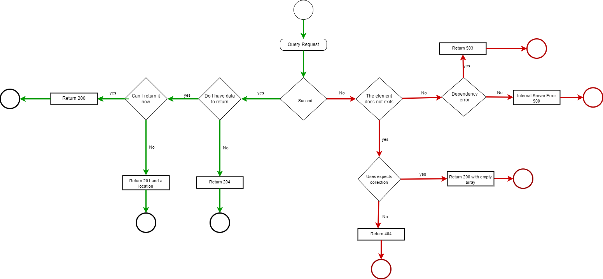
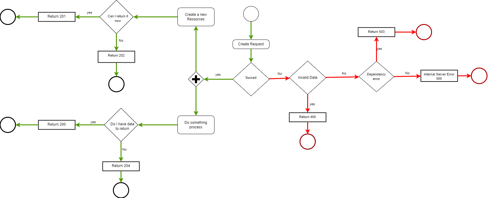
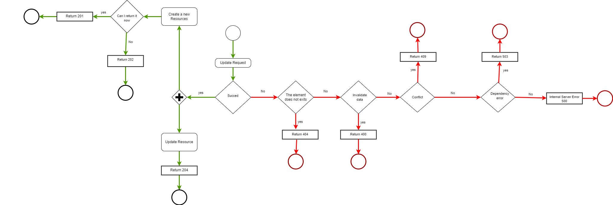
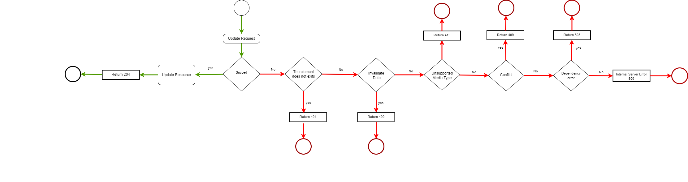
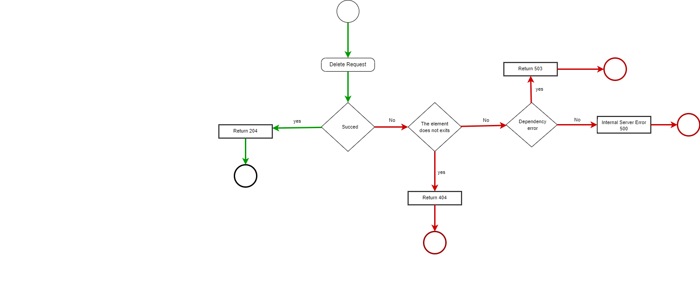

<div style="text-align: justify">

# Introduction
---
<br>

The __HTTP protocol__ defines a series of methods that assign semantic meaning to a request. The common HTTP methods used by most API are:


- __GET__ retieves a representation of the resource at the specified URI. The body of the response message contains the details of the requested resource.

- __POST__ creates a new resource the specified URI. The body of the request message provides the details of the new resource.
> :open_book: NOTE
>> That __POST__ can also be used trigger operations that don't actually create resources.

- __PUT__ creates or replaces the resource at the specified URI. The body of the request message specifies the resource to be created or updated.

- __PATCH__ performs a partial update of a resource. The request body specifies the set of changes that are applied to the resource.

- __DELETE__ removes the resource at the specified URI.

<br>

|__Resource__| __POST__ | __GET__ | __PUT__ | __DELETE__ 
|--|--|--|--|--|
|/customers  | Create a new cutomer|Get all customers  |Bulk update customers| Delete all customers 
| /customers/1 | Error |Retrieve details customer 1 |Bulk update customer 1 |Delete customer 1
|/customers/1/orders  |Create a new order for customer 1|Retrieve all orders for customer 1|Bulk update all orders for customer 1|Delete all orders for customer 1
| /dogs |Create a new dog|List all dogs| Bulk update all dogs|Delete all dogs
| /dogs/1234 |Create a new dog  |Show a Bob |Update Bob's details if exits if is not exists, response an error|Delete a Bob


# Differences between POST PUT PATCH
---
<br>

- A __PUT request__ creates a resource or updates an existing resource. The client specifies the URI of the resource. The request body contains a complete representation of the resource. If a resource with this URI already exists, it is replaced. Otherwise a new resource is created, if the server supports it. 

- __PUT requests__ are more often applied to resources that are individual items, for example a specific client, rather than collections. A server may support updates, but not PUT creation, if it depends on the client being able to meaningfully assign a URI to a resource before it exists. _If this is not the case, use POST to create resources and PUT or PATCH to update them_.

- __A PATCH request__ performs a partial update of an existing resource. The client specifies the URI of the resource. The request body specifies a set of changes to apply to the resource. This approach can be more efficient than using PUT, since the client only sends the changes, not the full representation of the resource. PATCH can also technically create a new resource (by specifying an update set on a "null" resource), if the server supports it.

> :open_book: NOTE
>> PUT requests __MUST be__ idempotent. If a client sends the same PUT request multiple times, the results should always be the same (the same resource will be modified with the same values). POST and PATCH requests _are not guaranteed to be idempotent_.

# GET Methods
---
<br>

- Normally, a succesful GET method returns the __HTTP status code 200__ (Succesful). If the resource is not found, the method return __HTTP status code 404__ (Not Found). 

- If the request has been fulfilled, but there is no response body included in the HTTP response, it __SHOULD__ return __HTTP status code 204__ (No content). For example, a find operation that produces no match could be implemented with this behavior.
<br>


## Specification GET operations OAS 3.0
---
### Paths
---

| __Parameter__ | __Description__  |__Example__ |
|--|--|--|
| __path__ | Path method. | /users/{id}|
|__summary__|A short summary of the method. It __MUST__ start with capital letter and end with a period. | Represents a user.|
|__description__|A long description of the method. It __MUST__ start with capital letter and end with a period. | This resource represents an individual user in the system.      Each user is identified by a numeric `id`.|
|__type of operation__|Type of operation method. Posible values<p> <p>get:<p> post:<p> put: <p> patch: <p> delete:  | get|


```yaml
paths:
  /ping:
    ...
  /users:
    ...
  /users/{id}:
    ...
```

```yaml
paths:
  /users/{id}:
    summary: Represents a user.
    description: >
      This resource represents an individual user in the system.
      Each user is identified by a numeric `id`.
    get:
      ...
    patch:
      ...
    delete:
      ...
```
### Operations
---

For each path, you define operations (HTTP methods) that can be used to access that path. OpenAPI 3.0 supports get, post, put, patch, delete, head, options, and trace. A single path can support multiple operations, for example GET /users to get a list of users and POST /users to add a new user. OpenAPI defines a unique operation as a combination of a path and an HTTP method. This means that two GET or two POST methods for the same path are not allowed – even if they have different parameters (parameters have no effect on uniqueness). 

<p>

| __Parameter__ | __Description__  |__Example__ |
|--|--|--|
| __reponse__ | Return HTTP status code, posible value:<p><p>200 <p><p>404<p><p>204 | responses:<p>'200':<p> description: OK<p>|
|__tags__|Used to group operations logically by resources or any other qualifier. See [Grouping Operations With Tags](https://swagger.io/docs/specification/grouping-operations-with-tags/).|Users|
|__summary__|A short summary of the operation. It __MUST__ start with capital letter and end with a period. | Gets a user by ID.|
|__description__|A long description of the operation. It __MUST__ start with capital letter and end with a period.|A detailed description of the operation.<p><p>Use markdown for rich text representation,such as **bold**, *italic*, and [links](https://swagger.io).|
|__externalDocs__|Used to reference an external resource that contains additional documentation.|externalDocs:<p><p>description: Learn more about user operations provided by this API.<p>url: http://api.example.com/docs/user-operations/|
|__opertaionId__|These IDs must be unique among all operations described in your API. __MUST be__ formed with Get prefix plus operation name __get__[OperationName]| getUserById


```yaml
paths:
  /ping:
    get:
      responses:
        '200':
          description: OK
```

```yaml
paths:
  /users/{id}:
    get:
      tags:
        - Users
      summary: Gets a user by ID.
      description: >
        A detailed description of the operation.
        Use markdown for rich text representation,
        such as **bold**, *italic*, and [links](https://swagger.io).
      operationId: getUserById
      parameters:
        - name: id
          in: path
          description: User ID
          required: true
          schema:
            type: integer
            format: int64
      responses:
        '200':
          description: Successful operation
          content:
            application/json:
              schema:
                $ref: '#/components/schemas/User'
      externalDocs:
        description: Learn more about user operations provided by this API.
        url: http://api.example.com/docs/user-operations/
components:
  schemas:
    User:
      type: object
      properties:
        id:
          type: integer
          format: int64
        name:
          type: string
      required:
        - id
        - name
```
# POST Methods
---
<br>

- If a POST method creates a new resource, it returns __HTTP status code 201__ (Created). If you create the resource asynchronously it returns __HTTP status code 202__ (Created).   The URI of the new resource is included in the Location header of the response. The response body contains a representation of the resource.

- If the method does some processing, __but doesn't create a new resource__, it can return __HTTP status 200__ and include the result of the operation in the response body. Or, if there are no results to return, the method can return __HTTP status code 204__ (No Content) with no response body.

- If the client puts invalid data into the request, the server should return __HTTP status code 400__ (Bad Request). The response body can contain additional information about the error or a link to a URI that provides more details.

<br>



## Specification GET operations OAS 3.0
---
### Paths
<br>

| __Parameter__ | __Description__  |__Example__ |
|--|--|--|
| __path__ | Path method. | /users|
|__summary__|A short summary of the method. It __MUST__ start with capital letter and end with a period. | Create a new user.|
|__description__|A long description of the method. It __MUST__ start with capital letter and end with a period. | Register a new user in the system.Each user is identified by a numeric `id`.|
|__type of operation__|Type of operation method. Posible values<p> <p>get:<p> post:<p> put: <p> patch: <p> delete:  | post|


```yaml
paths:
  /ping:
    ...
  /users:
    ...
  /users/{id}:
    ...
```

```yaml
paths:
  /users:
    summary: Create a new user.
    description: >
      Register a new user in the system, each user is identified by a numeric `id`.
    
    post:
      ...
    get:
      ...
    patch:
      ...
    delete:
      ...
```

### Operations
---
<br>


For each path, you define operations (HTTP methods) that can be used to access that path. OpenAPI 3.0 supports get, post, put, patch, delete, head, options, and trace. A single path can support multiple operations, for example GET /users to get a list of users and POST /users to add a new user. OpenAPI defines a unique operation as a combination of a path and an HTTP method. This means that two GET or two POST methods for the same path are not allowed – even if they have different parameters (parameters have no effect on uniqueness). 

<p>

| __Parameter__ | __Description__  |__Example__ |
|--|--|--|
| __reponse__ | Return HTTP status code, posible value:<p><p>201<p><p>202<p><p><p>200<p><p>204<p><p>400 | responses:<p>'201':<p> description: Created.<p>|
|__tags__|Used to group operations logically by resources or any other qualifier. See [Grouping Operations With Tags](https://swagger.io/docs/specification/grouping-operations-with-tags/).|Users|
|__summary__|A short summary of the operation. It __MUST__ start with capital letter and end with a period. | Create a new user.|
|__description__|A long description of the operation. It __MUST__ start with capital letter and end with a period.|A detailed description of the operation.<p><p>Use markdown for rich text representation,such as **bold**, *italic*, and [links](https://swagger.io).|
|__externalDocs__|Used to reference an external resource that contains additional documentation.|externalDocs:<p><p>description: Learn more about user operations provided by this API.<p>url: http://api.example.com/docs/user-operations/|
|__opertaionId__|These IDs must be unique among all operations described in your API. __MUST be__ formed with created prefix plus operation name __create__[OperationName]| createUser


```yaml
paths:
  /users:
    post:
      tags:
        - Users
      summary: Create a new user.
      description: >
        A detailed description of the operation.
        Use markdown for rich text representation,
        such as **bold**, *italic*, and [links](https://swagger.io).
      operationId: postUser
      responses:
        '201':
          description: Created.
      externalDocs:
        description: Learn more about user operations provided by this API.
        url: http://api.example.com/docs/user-operations/
```

# PUT Methods
---
<br>

- If a PUT method creates a new resource, it returns the __HTTP status code 201__ (Created) or __HTTP status code 202__ if you created the resource asynchronously, just as with a POST method.

- If the method updates an existing resource, it returns __HTTP status code 204__ (No Content).

- If it does not find the resource to update, it returns a __HTTP status code 404__ (Not Found).

- If the client puts invalid data into the request, the server should return __HTTP status code 400__ (Bad Request). The response body can contain additional information about the error or a link to a URI that provides more details.

- In some cases, it will not be possible to update an existing resource. In that case, consider returning the __HTTP status code 409__ (Conflict).

- Consider implementing bulk HTTP PUT operations that can batch updates to multiple resources in a collection. The PUT request must specify the URI of the collection, and the request body must specify the details of the resources to be modified. This approach can help reduce message exchange and improve performance.

<br>



## Specification GET operations OAS 3.0
---
### Paths
<br>

| __Parameter__ | __Description__  |__Example__ |
|--|--|--|
| __path__ | Path method. | /users/{id}|
|__summary__|A short summary of the method. It __MUST__ start with capital letter and end with a period. | Update a user.|
|__description__|A long description of the method. It __MUST__ start with capital letter and end with a period. | The user specified by his identifier in the system is updated.|
|__type of operation__|Type of operation method. Posible values<p> <p>get:<p> post:<p> put: <p> patch: <p> delete:  | put|


```yaml
paths:
  /ping:
    ...
  /users:
    ...
  /users/{id}:
    ...
```

```yaml
paths:
  /users/{id}:
    summary: Represents a user.
    description: >
      The user specified by his identifier in the system is updated.
    put:
      ...
    delete:
      ...
    get:
      ...
```


### Operations
---
<br>

For each path, you define operations (HTTP methods) that can be used to access that path. OpenAPI 3.0 supports get, post, put, patch, delete, head, options, and trace. A single path can support multiple operations, for example GET /users to get a list of users and POST /users to add a new user. OpenAPI defines a unique operation as a combination of a path and an HTTP method. This means that two GET or two POST methods for the same path are not allowed – even if they have different parameters (parameters have no effect on uniqueness). 

<p>

| __Parameter__ | __Description__  |__Example__ |
|--|--|--|
| __reponse__ | Return HTTP status code, posible value:<p><p>201 <p><p>202<p><p>204<p><p>404<p><p><p>400<p>409 | responses:<p>'204':<p> description: Updated.<p>|
|__tags__|Used to group operations logically by resources or any other qualifier. See [Grouping Operations With Tags](https://swagger.io/docs/specification/grouping-operations-with-tags/).|Users|
|__summary__|A short summary of the operation. It __MUST__ start with capital letter and end with a period. | Update a user.|
|__description__|A long description of the operation. It __MUST__ start with capital letter and end with a period.|A detailed description of the operation.<p><p>Use markdown for rich text representation,such as **bold**, *italic*, and [links](https://swagger.io).|
|__externalDocs__|Used to reference an external resource that contains additional documentation.|externalDocs:<p><p>description: Learn more about user operations provided by this API.<p>url: http://api.example.com/docs/user-operations/|
|__opertaionId__|These IDs must be unique among all operations described in your API. __MUST be__ formed with update prefix plus operation name __update__[OperationName]| updateUserById


```yaml
paths:
  /users/{id}:
    put:
      tags:
        - Users
      summary: Update a user.
      description: >
        A detailed description of the operation.
        Use markdown for rich text representation,
        such as **bold**, *italic*, and [links](https://swagger.io).
      operationId: getUserById
      parameters:
        - name: id
          in: path
          description: User ID
          required: true
          schema:
            type: integer
            format: int64
      responses:
        '204':
          description: Updated.
          
      externalDocs:
        description: Learn more about user operations provided by this API.
        url: http://api.example.com/docs/user-operations/

```

# PATCH Methods
---
<br>

- With a PATCH request, the client sends a set of updates to an existing resource, in the form of a patch document. The server processes the revision document to perform the update.
- If the revision document format is not supported, it returns __HTTP status code 415__ (Unsupported media type) 
- If the review document is incorrectly formatted, it returns __HTTP status code 400__ (Bad request) 
- The review document is valid, but the changes cannot be applied to the resource in its current state, it returns __HTTP status code 409__ (Conflict)
- If it does not find the resource to update, it returns a __HTTP status code 404__ (Not Found).
- The review document is valid, updates an existing resource, it returns __HTTP status code 204__ (No Content) 

<br>


## Specification GET operations OAS 3.0
---
### Paths
<br>

| __Parameter__ | __Description__  |__Example__ |
|--|--|--|
| __path__ | Path method. | /users/{id}|
|__summary__|A short summary of the method. It __MUST__ start with capital letter and end with a period. | Update a user.|
|__description__|A long description of the method. It __MUST__ start with capital letter and end with a period. | The user specified by his identifier in the system is updated.|
|__type of operation__|Type of operation method. Posible values<p> <p>get:<p> post:<p> put: <p> patch: <p> delete:  | patch|


```yaml
paths:
  /ping:
    ...
  /users:
    ...
  /users/{id}:
    ...
```

```yaml
paths:
  /users/{id}:
    summary: Represents a user.
    description: >
      The user specified by his identifier in the system is updated.
    patch:
      ...
    delete:
      ...
    get:
      ...
```


### Operations
---
<br>

For each path, you define operations (HTTP methods) that can be used to access that path. OpenAPI 3.0 supports get, post, put, patch, delete, head, options, and trace. A single path can support multiple operations, for example GET /users to get a list of users and POST /users to add a new user. OpenAPI defines a unique operation as a combination of a path and an HTTP method. This means that two GET or two POST methods for the same path are not allowed – even if they have different parameters (parameters have no effect on uniqueness). 

<p>

| __Parameter__ | __Description__  |__Example__ |
|--|--|--|
| __reponse__ | Return HTTP status code, posible value:<p>204<p><p>404<p><p><p>400<p><p>415<p>409 | responses:<p>'204':<p> description: Updated.<p>|
|__tags__|Used to group operations logically by resources or any other qualifier. See [Grouping Operations With Tags](https://swagger.io/docs/specification/grouping-operations-with-tags/).|Users|
|__summary__|A short summary of the operation. It __MUST__ start with capital letter and end with a period. | Update a user.|
|__description__|A long description of the operation. It __MUST__ start with capital letter and end with a period.|A detailed description of the operation.<p><p>Use markdown for rich text representation,such as **bold**, *italic*, and [links](https://swagger.io).|
|__externalDocs__|Used to reference an external resource that contains additional documentation.|externalDocs:<p><p>description: Learn more about user operations provided by this API.<p>url: http://api.example.com/docs/user-operations/|
|__opertaionId__|These IDs must be unique among all operations described in your API. __MUST be__ formed with updatePatch prefix plus operation name __updatePatch__[OperationName]| updatePatchUserById


```yaml
paths:
  /users/{id}:
    patch:
      tags:
        - Users
      summary: Update a user.
      description: >
        A detailed description of the operation.
        Use markdown for rich text representation,
        such as **bold**, *italic*, and [links](https://swagger.io).
      operationId: getUserById
      parameters:
        - name: id
          in: path
          description: User ID
          required: true
          schema:
            type: integer
            format: int64
      responses:
        '204':
          description: Updated.
          
      externalDocs:
        description: Learn more about user operations provided by this API.
        url: http://api.example.com/docs/user-operations/

```

# Delete Methods
---
<br>

- If the delete operation is successful, the web server should respond with __HTTP status code 204__ (No Content), which indicates that the process was handled successfully, but the response body contains no additional information.

- If the resource does not exist, the web server may return __HTTP status code 404__ (Not Found).

- Consider implementing bulk HTTP DELETE operations that can batch updates to multiple resources in a collection. The DELETE request must specify the URI of the collection, and the request body must specify the details of the resources to be deleted. This approach can help reduce message exchange and improve performance.

<hr>


## Specification GET operations OAS 3.0
---
### Paths
<br>

| __Parameter__ | __Description__  |__Example__ |
|--|--|--|
| __path__ | Path method. | /users/{id}|
|__summary__|A short summary of the method. It __MUST__ start with capital letter and end with a period. | Delete a user.|
|__description__|A long description of the method. It __MUST__ start with capital letter and end with a period. | The user specified by his identifier in the system is deleted.|
|__type of operation__|Type of operation method. Posible values<p> <p>get:<p> post:<p> put: <p> patch: <p> delete:  | delete|


```yaml
paths:
  /ping:
    ...
  /users:
    ...
  /users/{id}:
    ...
```

```yaml
paths:
  /users/{id}:
    summary: Represents a user.
    description: >
      The user specified by his identifier in the system is updated.
    delete:
      ...
    get:
      ...
   put:
      ...
```


### Operations
---
<br>

For each path, you define operations (HTTP methods) that can be used to access that path. OpenAPI 3.0 supports get, post, put, patch, delete, head, options, and trace. A single path can support multiple operations, for example GET /users to get a list of users and POST /users to add a new user. OpenAPI defines a unique operation as a combination of a path and an HTTP method. This means that two GET or two POST methods for the same path are not allowed – even if they have different parameters (parameters have no effect on uniqueness). 

<p>

| __Parameter__ | __Description__  |__Example__ |
|--|--|--|
| __reponse__ | Return HTTP status code, posible value:<p>204<p><p>404 | responses:<p>'204':<p> description: Deleted.<p>|
|__tags__|Used to group operations logically by resources or any other qualifier. See [Grouping Operations With Tags](https://swagger.io/docs/specification/grouping-operations-with-tags/).|Users|
|__summary__|A short summary of the operation. It __MUST__ start with capital letter and end with a period. | Delete a user.|
|__description__|A long description of the operation. It __MUST__ start with capital letter and end with a period.|A detailed description of the operation.<p><p>Use markdown for rich text representation,such as **bold**, *italic*, and [links](https://swagger.io).|
|__externalDocs__|Used to reference an external resource that contains additional documentation.|externalDocs:<p><p>description: Learn more about user operations provided by this API.<p>url: http://api.example.com/docs/user-operations/|
|__opertaionId__|These IDs must be unique among all operations described in your API. __MUST be__ formed with Delete prefix plus operation name __delete__[OperationName]| deleteUserById


```yaml
paths:
  /users/{id}:
    delete:
      tags:
        - Users
      summary: Delete a user.
      description: >
        A detailed description of the operation.
        Use markdown for rich text representation,
        such as **bold**, *italic*, and [links](https://swagger.io).
      operationId: getUserById
      parameters:
        - name: id
          in: path
          description: User ID
          required: true
          schema:
            type: integer
            format: int64
      responses:
        '204':
          description: Deleted.
          
      externalDocs:
        description: Learn more about user operations provided by this API.
        url: http://api.example.com/docs/user-operations/

```

# Query a listing using POST verb instead of GET
---
<br>

## When ?
---
<br>

- Due to a technical restriction of the API Gateway, if in the query it is going to be possible to filter by a list and it is going to suppose a length greater than 2000 characters in the URI, it is prescribed to use the HTTP POST verb in the API instead of GET, and they will be informed the filter parameters in the request body.

- If we have __more than 10 fields to filter__ listing using post instead of GET 

- Also, in case of informing parameters of a sensitive nature, they must be informed (as in the previous case) in the body of the request. Examples of these parameters could be: ID numbers, application names, non-public codes, etc.

## How ?
---
<br>

- This casuistry impacts the design of the API, and the following table summarizes how to apply the design


|__Case__| __Resource__ |__Path__  |__Action__  |__Verb HTTP__  |__operationId__  | __Explanation__ |
|--|--|--|--|--|--|--|
|  A|SalesOrder  |/sales-order/list  |Query  |POST  |getSalesOrdersUsingPOST  |<b>o</b> We have an end-point to perform the query (GET) but for a technical solution, it could be that we work with lists and the path accumulates more than 2000 characters, we have to use the POST verb and add the filter parameters in the request body.<p><p><b>o</b> The suffix "/list" is included in the path to indicate that a query is being made, returning a list of the resource.<p><p><b>o</b>The operationId is suffixed with <b>"UsingPOST"</b> to indicate that the HTTP POST verb is being used and also to differentiate from the operation defined (case C) as getSalesOrders.  |
|  B| SalesOrder |/sales-order  | to register  | POST |createSalesOrder  | Register using POST verb.|
|  C|SalesOrder  |/sales-order|Query  |GET  | getSalesOrders |Query using GET verb.|


</div>