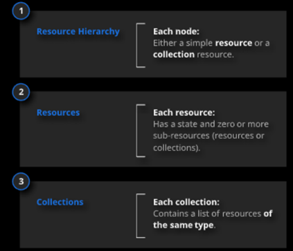

<div style="text-align: justify">

# Identifying a resource
---
<br>


A URI (Uniform Resopurce Identifier) is a compact string of characters used to identify an abstract or physical resource ([RFC 3986](https://datatracker.ietf.org/doc/html/rfc3986)).

The generic requirements for designing the URI scheme are as follows:

- A consistent extensible and persistent URI composition structure __MUST__ be used, applying construction rules with certain patterns that offer consistency in uniformity.

- URIs __MUST__ follow and understandable and revelant composition structure. The identifier itself __MUST__ offer self-contained semantic information, which will allow any API user to have allow any API user to have information about the resources itself, as well as its origin.
  
- URIs __MUST__ adhere to the persistence principle(previously created URIs __SHOULD__ never vary)
- URIs __MUST__ ensure that the content they refer to is accesible. In the event that the resource pointed to by an identifier needs to be changed or remoeved, a resource status reporting mechanism __MUST__ be established using HTTP status codes(explained below).   

- __PENDING__ (reference to Security Division) The HTTPS protocol __MUST__ be used, in order to guarantee the secure resolution of any URI on the Web. For example, in OAuth 2.0, in the most common security configuration, there is access information (Access Token).

# Basic structure of a URI
---
<br>

Any resource __MUST__ have a URI that uniquely identifiles it form all other resources. This identifier __MUST be__ a unique reference for each resource, allowing its addressing and, therefore, access to the associated information.

A generic URI is structured into segments as follows:

```csharp
{schema}://{authority}/{api_name}/{api_surname}/v{version}/{resource}/{subresource}/{...}/?{param=value}&{...}
```
## Segments of URI
---
<br>

-  **{schema}**: protocol on which it works. It is recommended that it always be HTTPS.
-  **{authority}:** DNS name or IP address of the server to which access is intended. If it is not the standard, the port number assigned to the API service will be added. If you decide to locate the API on a different subdomain, CORS MUST be implemented on the server so that some URLs support calls from other domains.
- **{api_name}**: API name.
- **{api_surname}**: 2nd name / surname of the API.
- **{version}**: API version.
- **{resource}**: resource to be accessed, together with the path params.
- **{subresource}**: resource to be accessed, together with the path params.
- **{param=value}**: filter parameters (query params ).

# Design rules for a URI
---
<br>

> :open_book: NOTE

>> A resource does not have to be based on a single physical data element. For example, an order resource could be internally implemented as multiple tables in a relational database, but presented to the customer as a single entity. Avoid creating APIs that simply reflect the internal structure of a database. The purpose of REST is to model entities and the operations that an application can perform on those entities. A client should not be exposed to the internal implementation.
>> 


- The maxium size of a URI canot exceed __2000 characters__(after all Path Params and Query Params are added). 
- Atomic, compound and collectible resources __MUST be__ named with _nouns_ as they designate a person, animal and object in general way and __not "actions"__. Examples: users, customers, articles, payroll, etc.


|__Example__| :thumbsup: :thumbsdown: |
|---|:---:|
| **POST**  https://adventure-works.com/{apiname}/v1/orders|  :thumbsup:|
|**POST** https://adventure-works.com/{apiname}/v1/create-order |:thumbsdown:|


- Controller and function resources __MUST be__ named with verbs, as they represent “_actions_”. Example: update-mail.
- Controller and functions resources __MUST NOT be__ sub-resources of other individual resources.
thid has two consecuences:
       
  **1.** Individual resources __MUST be__ provided as. 
  **2.** __MUST NOT be__ part of a URI template.
- The noun __MUST be__ used in the plural, as it allows interaction with both a collection of resources (multiple records) and a single resource (single record).

|__Example__| :thumbsup: :thumbsdown: |
|---|:---:|
| **GET** https://adventure-works.com/{apiname}/v1/articles|  :thumbsup:|
|**GET** https://adventure-works.com/{apiname}/v1/article |:thumbsdown:|

- __Should be__ select unique short alphanumeric identifiers, which are representative, intuitive and semantic and MUST meet all of these conditions:

     **o** Names __MUST contain__ at least one character.
     **o** Names __MUST contain__ only the characters allowed. 
     **o** Names __MUST start and end with__ a globally allowed character.
     **o** Names __MUST not contain__ reserved characters

| __Code__  |Character  | Comments |
|--|--|--|
| U+0061 a U+007A | 	"a-z" |  |
|U+0041 a U+005A  | "A-Z" |  |
| U+0030 a U+0039 | 	"0-9" |  |
|U+0080 y superiores  |  | Non-ASCII characters __SHOULD not be__ used. |
|U+002D HYPHEN-MINUS  |  "-"| Except for the first and last character. |
| U+005F LOW LINE	 | "_" | Except for the first and last character.. |
| U+0020 SPACE| " " | Except for the first and last character. |
- You __MUST__ always use lower case. [RFC 3986](https://www.ietf.org/rfc/rfc3986.txt) states that URIs are case sensitive, except in the {scheme} and {host} segments.
- All accents, umlauts, and punctuation symbols __MUST be__ removed. As an exception, the hyphen (–) can be used.
- Conjunctions and articles __MUST be__ eliminated in cases where the concept to be represented contains more than one word.
- In very long resource names, words can be separated using the _hyphen_.

|__Example__| :thumbsup: :thumbsdown: |
|---|:---:|
| **GET** https://adventure-works.com/{apiname}/v1/long-name-resource  |  :thumbsup:|
|**GET** https://adventure-works.com/{apiname}/v1/longnameresource |:thumbsdown:|
|**GET** https://adventure-works.com/{apiname}/v1/longNameResource |:thumbsdown:|
- Abbreviation of words __SHOULD be__ avoided, unless the abbreviation is intuitive and self-explanatory.
- The "/" separator __MUST be__ used to indicate hierarchical relationships.

|__Example__| :thumbsup: :thumbsdown: |
|---|:---:|
|**GET** …/entities1/{entity_id1}/entities2/{entity_id2}|  :thumbsup:|
|**GET** …/entities1/{entity_id1}/entities2 |:thumbsup:|
|**GET** …/entities1/{entity_id1}/entities2/{entity_id2}/entities3 |:thumbsup:|
|**GET**…/customers/{id} |:thumbsup:|
|**GET** …/customers/5/orders |:thumbsup:|
|**GET** /orders/99/customers|

|__Example__| :thumbsup: :thumbsdown: |
|---|:---:|
|**POST** …/entities1/entities2/|  :thumbsup:|
|**POST** …/entities1/{entity_id1}/entities2/entities3|:thumbsup:|


> :open_book: NOTE

>> **o** The entity_id 1 and entity_id 2 identifiers are defined in the body of the post request if the identifiers have sensitive information and cannot be passed through the URI.
>> **o** The entity_id2 identifier is defined in the body of the POST request because it contains sensitive information. 
- Resource names __MUST NOT end__ with the "/" separator, as it adds no semantic value and causes confusion, as two different URIs would point to the same resource.

|__Example__| :thumbsup: :thumbsdown: |
|---|:---:|
|…/resource|  :thumbsup:|
…/resource/ |:thumbsdown:|
- The "_" separator __MUST NOT be__ used in the URI. Most applications (editors, browsers, etc.) tend to underline URIs to provide a visual indication that they are clickable. Depending on the application font, this underline may hide the first one. To avoid such confusion, the hyphen __MUST be__ used.

|__Example__| :thumbsup: :thumbsdown: |
|---|:---:|
|…/my-resource|  :thumbsup:|
…/my_resource/ |:thumbsdown:|
- Nouns __MUST be__ used in the name of the resources, leaving the action performed on them for the "verb" that will constitute the service being invoked.

|__Example__| :thumbsup: :thumbsdown: |
|---|:---:|
|**GET** …/articles/123|  :thumbsup:|
|**GET** …/articles/GET?id=123|:thumbsdown:|
|**GET** …/articles/GET/123|:thumbsdown:|
|**GET** …/getArticles?id=123|:thumbsdown:|
> :open_book: NOTE

>> The exception where the use of a verb in a URI will be allowed will be controller names. In this case the name of the operation MUST be included in the last segment of the URI, with no nested parameters or resources, invoked with a POST.

|__Example__| :thumbsup: :thumbsdown: |
|---|:---:|
|**POST** …/employees/personal-data/query
Content-Type: application/json; charset=UTF-8<p>{<p>"data": {<p>"userNif": "12345678X"<p> }<p>}|  :thumbsup:|
- Information about the technical implementation of the resources represented by the URIs __SHOULD not be__ exposed. Specific information about the underlying technology of the represented resource will be omitted; for example, the extensions corresponding to technologies with which web resources are generated, such as .php, .jsp, etc., will not be included.

|__Example__| :thumbsup: :thumbsdown: |
|---|:---:|
|…/my-resource/...|  :thumbsup:|
…/my-resource/pdf/... |:thumbsdown:|

- In the path of an end-point that exposes a resource, informing itself to the right of it, WITHOUT INFORMING the unique identifier key:
  **o** When we want to return a single resource (GET(R)), we end the resource name in SINGULAR.
  **o** When we want to return a list of resources (GET(L)), we end the name of the resource in PLURAL.

|__Example__| :thumbsup: :thumbsdown: |
|---|:---:|
|**GET**…/continents/3/countries/34/regions/46/locations/12/population|  :thumbsup:|
|**GET** …/continents/3/countries/34/regions/46/locations/12/populations|:thumbsdown:|
|**GET**…/continents/3/countries/34/regions/46/locations|  :thumbsup:|
|**GET**…/continents/3/countries/34/regions/46/location|:thumbsdown:|

## Practical examples of URI construction with various related entries
--- 
<br>

|__Use Case__| Examples |
|---|:---:|
||<b>o</b> Get the list of articles a store, given its identifier.<p><table><th>Example</th><th>:thumbsup: :thumbsdown:</th><tr><td><b>GET</b>…/sites/{sitePublicId}/articles</td><td>:thumbsup:</td></tr></table><p><p><b>o</b> Get article by its identifier and by the identifier of the store.<p><table><th>Example</th><th>:thumbsup: :thumbsdown:</th><tr><td><b>GET</b>…/sites/{sitePublicId}/articles/{articlePublicId}</td><td>:thumbsup:</td></tr></table>|

<br>

|__Use Case__| Examples |
|---|:---:|
||<b>o</b> Get the list of users registered in the system.<p><table><th>Example</th><th>:thumbsup: :thumbsdown:</th><tr><td><b>GET</b> …/authorities/users</td><td>:thumbsup:</td></tr></table><p><p><b>o</b> Get the list of applications registered in the system.<p><table><th>Example</th><th>:thumbsup: :thumbsdown:</th><tr><td><b>GET</b>…/authorities/applications</td><td>:thumbsup:</td></tr></table><p><p><b>o</b> Get the list of applications that a user is authorized in the system.<p><table><th>Example</th><th>:thumbsup: :thumbsdown:</th><tr><td><b>GET</b>…/authorities/users/{userId}/applications</td><td>:thumbsup:</td></tr></table><p><p><b>o</b> Get the list of users registered in an application.<p><table><th>Example</th><th>:thumbsup: :thumbsdown:</th><tr><td><b>GET</b>/authorities/applications/{applicationId}/users</td><td>:thumbsup:</td></tr></table>|

<br>


|__Use Case__| Examples |
|---|:---:|
||<b>o</b> Get the list of roles defined in an application.<p><table><th>Example</th><th>:thumbsup: :thumbsdown:</th><tr><td><b>GET</b>…/authorities/applications/{applicationId}/roles</td><td>:thumbsup:</td></tr></table><p><p><b>o</b> Get the list of roles assigned to a user in an application.<p><table><th>Example</th><th>:thumbsup: :thumbsdown:</th><tr><td><b>GET</b>…/authorities/applications/{applicationId}/users/{userId}/roles</td><td>:thumbsup:</td></tr></table>|

<br>

|__Use Case__| Examples |
|---|:---:|
||<b>o</b> Get the list of operation groups assigned to a user in an application.<p><table><th>Example</th><th>:thumbsup: :thumbsdown:</th><tr><td><b>GET</b>…/authorities/applications/{applicationId}/users/{userId}/operation-groups</td><td>:thumbsup:</td></tr><p><p></table><p><p><b>o</b> Get the list of groups of operations defined in an application.<p><table><th>Example</th><th>:thumbsup: :thumbsdown:</th><tr><td><b>GET</b>…/authorities/applications/{applicationId}/operation-groups</td><td>:thumbsup:</td></tr></table>|

<br>

|__Use Case__| Examples |
|---|:---:|
||<b>o</b> Get the list of operations defined in an application.<p><table><th>Example</th><th>:thumbsup: :thumbsdown:</th><tr><td><b>GET</b>…/authorities/applications/{applicationId}/operations</td><td>:thumbsup:</td></tr></table>|


# Parameters
---
<br>
The parameters are options included in the URI of the resources and that have an influence on the response obtained. There are four types of parameters:
<p>

| __Type__ | __Description__ |
|--|--|
|__header parameters__  | They are included in the headers of HTTP messages.|
|__path parameters__ |The are part of the {resource} segment of the URI and are placed before query string. A characteristic aspect of these parameters is that the order is important.  |
|__query string parameters__  |They appear in the {query_string} segment of the URI as list of attribute=value pairs separated by the "&" character. The order is not important and they are writen in camelCase (lowerCase initial) format.     |
|__request body parameters__  |They are in the body of the HTTPS request message and are usually sent in JSON format. The recommendations for this type of parameters will be established in [Defining-input-and-output-fields](/Home/API-Governance-Methodology/How-to-build-an-API/Guides/API-Design-Guide/Defining-input-and-output-fields)    |

## Rules for Path Parameters
---
<br>

- __Path parameters__ are entity identifiers and __MUST follow__ the entity they refer to.
The have the generic format of:

```
…/entity1/{entity_id1}/entity2/{entity_id2}…
``` 

|__Example__| :thumbsup: :thumbsdown: |
|---|:---:|
| **GET** .../articles/123|  :thumbsup:|
|**GET** .../123/articles |:thumbsdown:|

<p>

- On the other hand, two _Path parameters_ __MUST NOT be__ included consecutively as it would not be possible to identify the entity to which they correspond.

<p>

|__Example__| :thumbsup: :thumbsdown: |
|---|:---:|
| **GET** .../sites/456/articles/123|  :thumbsup:|
|**GET** ...sites/456/123/articles |:thumbsdown:|


## Rules for Query Parameters
---
<br>

- The query string of URI contains a set of parameters that are interpreted as a variation of the resource and that can provide API users with functionally such as searching or filtering. For example, in a resource with the following structure:

```json

"identity": 
{ 
    "type": "DNI", 
    "number": "7021234" 
}

```
- Filtering by these fields __MUST respect__ the hierarchy established in the resource model.

|__Example__| :thumbsup: :thumbsdown: |
|---|:---:|
| **GET** …/?identityType=DNI&identityNumber=231245|  :thumbsup:|
|**GET** …/?type=DNI&number=231245 |:thumbsdown:|

## When do I report parameters in the path or in the query
---
<br>

- In the __Path__ the parameters that are __mandatory and univocal that are primary keys__ of the resources to be obtained are reported. In addition, in its use it is intended to obtain a single resource. 

- When we have primary keys composed and conditioned by the systems for example, could be the case of the numbering of center code, which can follow SAP or Legacy numbering, the parameters are reported in the __query__. In these cases, the SAP code and Legacy code parameters __MUST go__ in the __query__ since both cannot be set as mandatory, because depending on the source system, you can filter by one or the other.
- In addition, the rest of the fields that make up the primary key will also go in the __query__ because if they are reported in the __Path__ they can generate confusion at the consumer level showing that the primary key is another.

> :airplane: REFERENCES
>>  https://medium.com/@fullsour/when-should-you-use-path-variable-and-query-parameter-a346790e8a6d <p>
>> https://stackoverflow.com/questions/4024271/rest-api-best-practices-where-to-put-parameters

# Filtering the results
---
<br>

- Filtering of resource lists MUST be performed using the URI query parameters:

```
GET /products?type=fresh&costFrom=10&costTo=20
```

- In case the query value is a list of values, they __MUST be__ concatenated separated by commas

```
GET /trainings?day=monday,tuesday
```
- To consider the number of query parameters allowed via a GET request is limited to 10 parameters. If this number is exceeded, the operation must be converted to POST .

     **o** Adding the filter parameters in the request body.

     **o** The suffix "/list" is included in the path to indicate that a query is being made, returning a list 
           of the resource.

     **o** The operationId is suffixed with "UsingPost" to indicate that the HTTP POST verb is being used and also to differentiate from the operation defined as getSites.


# Order
---
## Ordering of input parameters
---
<br>
The ordering of input parameters MUST be done as follows:
<p><p>

**1.** Parameters of the route with the order in which they appear in the route.<p>
**2.** Parameters of the query-string (Filters that are not from the route, that is, everything that appears after the question mark).<p>

1. Identifiers
   1.id
2. Rest of parameters except pagination and ordering of fields.
3. Paging parameters.
4. Field ordering parameter.

## Ordering of Results
---
<br>

- Resource list ordering SHOULD be performed using the two resource URI query parameters with the following recommendations:<p>
    **o** It __MUST only be__ used in GET verbs of resources of type collection with the query parameter order.
         ```
         GET /resource?order=+field1
         ```

   **o** When filtering by a single field, '+' __MUST be__ used to indicate ascending order and '-' for descending order.
         ```
         Upward 
         GET /resource?order=+field1
         ```
         ```
         Falling 
         GET /resource?order=-field1
         ``` 
**o** When filtering by several fields, a list of the fields __MUST be__ indicated in the order in which the ordering is desired and with the ordering direction for each one of them.
         ```
         GET /resource?order=+field1,-field2
         ```

# Pagination
---
<br>

## Paging request
---
<br>

- To build the paging request, we recommend, as a good practice, the use of a structure that contemplates the firstPage and sizePage fields.


|__Field__| ___Description__  |
|--|--|
|__firstPage__|Requested page, is the first page we want to display. By default, it will be 1 (“default”: 1) for consumption of screen applications that want to display the results in pages and the "default" parameter will not be used in the case of batch applications where they want to return all the information at once.  |
|__sizePage__|Page size, the total size of the result that we will have per page. By default, it will be 10 (“default”: 10) for consumption of screen applications that want to display the results in pages and the "default" parameter will not be used in the case of batch applications where they want to return all the information at once. (eg '10' = page 1 above has 10 results, ie page 2 will show 11 to 20)  |

```json

"parameters": [
  {
      "name": "firstPage",
      "in": "query",
      "description": "Requested page (first page is page 1). If not specified 1 is used. [Cannot be negative]",
      "required": false,
      "type": "integer",
      "format": "int32",
      "default": 1
  },
  {
      "name": "sizePage",
      "in": "query",
      "description": "Number of retrieved elements per page. If not specified 10 is used. [Cannot be less than 1]",
      "required": false,
      "type": "integer",
      "format": "int32",
      "default": 10
}
]

```

- If you do not want to use the "default" parameter for the paging request and you are going to develop a logic to discern the mandatory nature of parameters such as firstPage or sizePage, we prescribe that this logic be implemented at the API Gateway level and in the backend application.

## Paging Response
---
<br>

- To build the paging response, we recommend as a good practice the use of a structure that contemplates the fields _requestedPage_, _requestedSize_, _retrievedResults_, _totalResults_, _nextPage_ and _previousPage_.


| __Field__ |__Description__  |
|--|--|
|__requestedPage__|Requested page, its value must match the value of the request field, firstPage.  |
|__requestedSize__|Requested page size, its value must match the value of the request field, sizePage.|
|__retrievedResults__|Numeric that expresses the total results returned by the backend for rendering the page.|
|__totalResults__|Numeric expressing the total results returned by the backend for full paging, matching the total number of records in the database table.  |
|__nextPage__|Page following the one requested. Indicates the path of the link to execute. When the requested page (requestedPage) is the last one, the next page field (nextPage) will show empty.|
|__previousPage__|Previous page to the one requested. Indicates the path of the link to execute. When the requested page (requestedPage) is the first one, the previous page field (previousPage) will be empty.  |


```json

"requestedPage": {
    "type": "integer",
    "format": "int32"
},
"requestedSize": {
    "type": "integer",
    "format": "int32"
},
"retrievedResults": {
    "type": "integer",
    "format": "int32"
},
"totalResults": {
    "type": "integer",
    "format": "int64"
},
"nextPage": {
    "type": "string",
    "example": "localhost:8080/demo/products/sales-product/v1/products?firstPage=2&pageSize=10"
},
"previousPage": {
    "type": "string",
    "example": "localhost:8080/demo/products/sales-product/v1/products?firstPage=1&pageSize=10"
}

```

>  :airplane:  REFERENCES
>>  https://nordicapis.com/everything-you-need-to-know-about-api-pagination/
>>
>>  https://serpapi.com/pagination
>>
>>  https://www.odata.org/getting-started/basic-tutorial/#entitySet


</div>